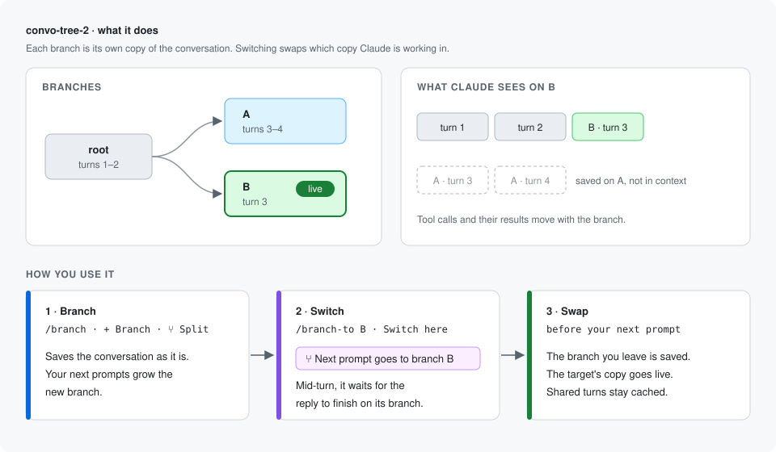
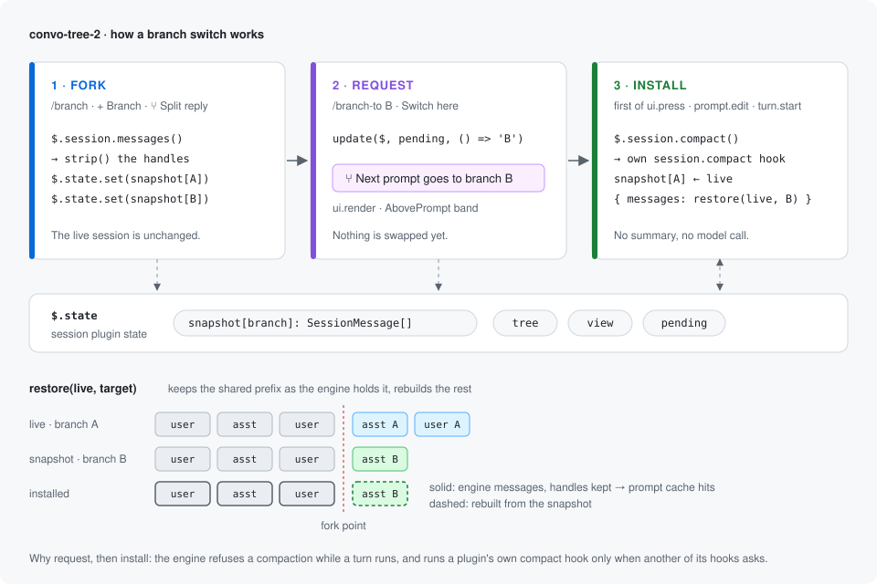
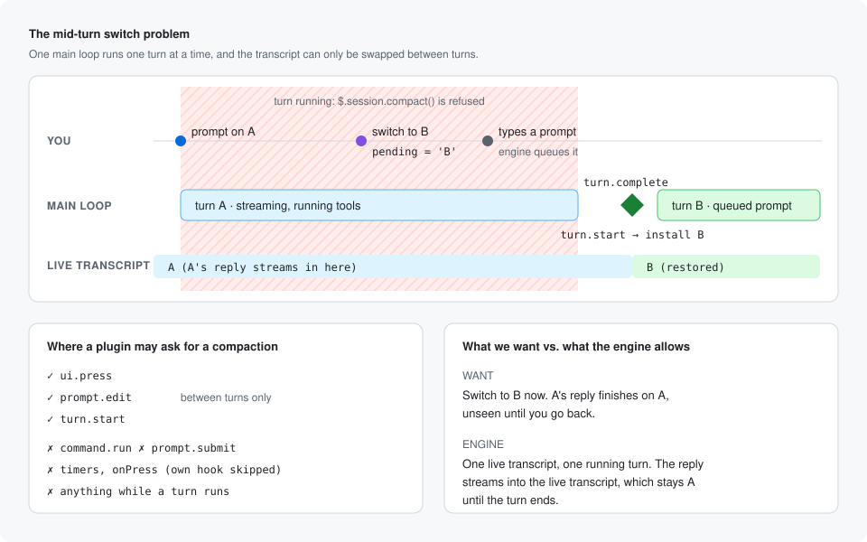
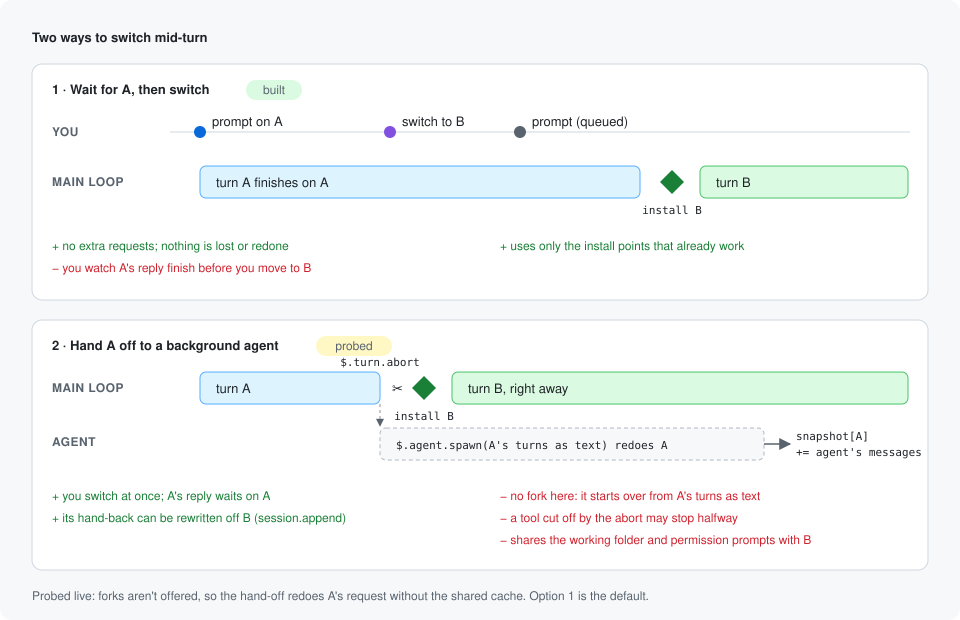

# convo-tree-2

[convo-tree](../convo-tree) with the same pane, browser map and commands, but branches are real forks of the session. In convo-tree the conversation stays linear and branches only group its turns. Here, switching to a branch swaps the live transcript for that branch's own, so from then on your prompts and Claude's context are that fork alone, tool calls included.

## How it works

- **Branch** (`/branch [label]`, **+ Branch**, **⑂ Split reply**): saves the live transcript as the snapshot of both the parent and the new branch. Nothing changes in the session yet. Your next prompts grow the new branch.
- **Switch** (`/branch-to <branch>`, **Switch here**, a double-click in the browser map): the switch is requested, and a band above the prompt shows where your next prompt goes. It is installed at the first of: your next press in a pane, your first keystroke in the prompt box, or the start of your next turn. Claude never reads a prompt that was meant for the old branch.
- **Install**: a compaction that convo-tree-2 answers itself, with no summary and no model call. The live transcript is saved as the snapshot of the branch being left, and the target branch's snapshot takes its place. Messages at the start that both branches share are kept as the engine holds them. Only the messages after the fork point are rebuilt from the snapshot.

The engine runs a plugin's own `session.compact` hook only when the compaction is requested from another of its hooks (a press, a prompt edit, a turn start). A request from a command, a prompt submit, a timer or a button handler doesn't count. That's why a switch is requested first and installed afterwards.

## Commands

| Command | Does |
|---|---|
| `/tree` | Open the pane |
| `/tree-web` | Open the browser map |
| `/branch [label]` | Fork the session into a new branch; your next prompts go there |
| `/branch-to <branch>` | Switch the session to another branch (new in convo-tree-2) |
| `/branches` | List branches as text |
| `/branch-agent <branch> <task>` | Run a subagent on one branch |

The commands are convo-tree's, so install one of the two, not both.

## Plan and status

| Step | Status |
|---|---|
| Copy convo-tree as a separate plugin, keeping its commands and UI | Done |
| Snapshot the live transcript per branch on fork and on leaving a branch | Done |
| Swap transcripts with a self-answered `session.compact` | Done, tested against the plugin test kit |
| Request then install switches (press, prompt edit, turn start); band above the prompt | Done |
| Block forks and splits mid-turn (the rest of the turn would land on the fork) | Done |
| Try it in a live session: check that the swap leaves the visible transcript and the prompt cache in the state expected | **Open** |
| Branch subagents get the branch's full snapshot instead of its prompt/reply text | Next |
| Switch mid-turn, with the running turn finishing on the branch it started on (see below) | Explored |
| Rename, delete and merge forks | Later |

## Switching mid-turn (explored, not built)

Today a switch asked for mid-turn waits for the turn to end. The aim is to switch at once, let the running request finish on its own branch, and show its reply only when you go back. The engine runs one main turn at a time and refuses a compaction while one runs, so the running turn has to be handed to a background loop:

The hand-off would go:

1. **Hand off.** `$.turn.abort({ turnId })` stops the main turn. Then `$.agent.spawn({ subagentType: 'fork', prompt: 'Finish the request you were on.' })` starts a background fork, which inherits the transcript as it stood, tool results included, and shares its cached prefix.
2. **Switch.** The main turn has ended, so the usual install runs: snapshot A is saved, and B takes its place.
3. **Land.** On the fork's `turn.complete` (matched by `agentId`), `$.session.messages({ agentId })` gives the fork's new messages. They are appended to snapshot A, A's reply is set in the tree, and the pane marks A as updated. Going back to A installs them.

Open questions, to settle with a live probe before building it:

- Whether a plugin's `$.agent.spawn` may name `fork`. The types allow it, but the engine may refuse.
- The background agent's completion notice reaches the main loop, which would put A's reply in B's context. It would need to be dropped.
- Work is lost at the abort: the step that was streaming is redone, and a tool cut off mid-run may leave partial side effects.
- The fork and B's turns share one working directory. Edits could collide unless the fork gets its own `cwd`, such as a worktree.
- Permission prompts from the fork show up while you're on B.
- Going back to A before the fork finishes means waiting, or installing a partial A.

Rough size: about 150 lines and tests once the probe answers the first two questions.

## Limits and risks

- **Not yet tried live.** The test kit doesn't fill `e.messages` for a compaction a plugin asks for, so the tests use the `$.session.messages()` fallback. In a live session, check that the engine hands its transcript, with handles, to the hook.
- **The prompt cache after a switch.** The shared opening is kept as the engine holds it, so it should hit. The branch's own part hits only if its cache entry hasn't expired and the rebuilt messages match what was sent before byte for byte, which isn't guaranteed. Check `cache_read_input_tokens` on the first turn after a switch.
- **Snapshots are rebuilt from message summaries.** Text, tool calls and tool results come back. Images and thinking blocks in the part after the fork point may not.
- **An automatic compaction on a branch** compacts that branch's live transcript, as usual. Its snapshot is the compacted one from then on, and other branches keep theirs.
- Snapshots live in the session's plugin state, not on disk. They last as long as the session.
- The Claude mobile app does not dock panes; `/tree` there says whether the pane was drawn and lists the branches as text.
- Everything else (pane, browser map, Haiku titles and summaries, bun requirement) is as in [convo-tree](../convo-tree/README.md).

## Layout

| Path | What it is |
|---|---|
| `hooks/register.tsx` | Hooks, commands, the fork and switch logic, the branch agent, the pane, the band, the browser bridge |
| `hooks/tree.ts` | The tree's data functions and the snapshot `strip`/`restore` helpers |
| `browser/` | The browser map and its bun server, unchanged from convo-tree |
| `hooks/convo-tree-2.test.tsx` | Tests: `claude plugin test plugins/convo-tree-2` |
